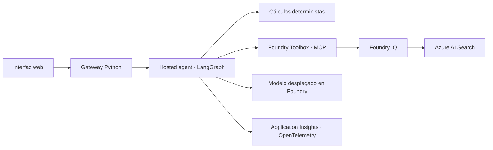

# Manufacturing Operations Assistant

Asistente de producción basado en **Microsoft Foundry**, **LangGraph**,
**MCP**, **Foundry IQ** y **Azure AI Search**.

Ayuda a un responsable de producción a revisar desviaciones, consultar
procedimientos documentados, comparar alternativas energéticas y preparar
el relevo de turno desde una interfaz web.

> Aplicación de referencia con datos sintéticos y procedimientos ficticios.
> No está conectada a sistemas industriales ni está preparada para operar
> maquinaria. Las respuestas son borradores que requieren revisión humana.

## Caso de uso

Una planta dispone de cinco líneas: Mecanizado, Ensamblaje, Acabado,
Inspección y Embalaje. En el escenario incluido, Ensamblaje registra un
tiempo de ciclo de **118 segundos por pieza frente a una referencia de 100**.

El asistente permite:

| Capacidad | Resultado |
|-----------|-----------|
| Supervisión de producción | Identificar líneas cuyo tiempo de ciclo requiere revisión, sin diagnosticar averías. |
| Consulta de procedimientos | Recuperar documentación desde Foundry IQ y mostrar el fragmento utilizado. |
| Comparación energética | Comparar el coste supuesto y la proporción renovable para el mismo lote y consumo. |
| Parte de turno | Preparar un borrador con observaciones, evidencias pendientes y siguiente revisión humana. |

El incremento del tiempo de ciclo es del 18 %; no equivale a una reducción
del rendimiento del 18 %. La comparación energética mantiene **1.000 piezas
y 500 kWh** en ambas alternativas: cambia el precio supuesto y el origen
renovable, no el consumo. No representa un ahorro real verificado.

## Arquitectura



- **Gateway:** sirve la interfaz, valida peticiones y llama al endpoint
  Responses del hosted agent.
- **Hosted agent:** ejecuta los cálculos, recupera el procedimiento apropiado
  por MCP y solicita al modelo una respuesta apoyada en esa evidencia.
- **Foundry IQ:** recuperación extractiva mínima sobre un índice Search.
  Esta implementación no utiliza búsqueda vectorial ni planificación de
  consultas mediante otro LLM.
- **Trazas:** un contexto OpenTelemetry por ejecución, propagado a las
  llamadas MCP y al modelo. La interfaz muestra el Trace ID completo.
- **Autenticación:** Azure CLI para desarrollo local, identidad administrada
  para el gateway en Azure y Microsoft Entra ID para los usuarios de la web.

No hay integración con MES, ERP, PLC, sensores o Microsoft Fabric.

## Estructura

```text
web/                         Interfaz HTML, CSS y JavaScript
server.py                    Gateway HTTP y autenticación de peticiones
auth.py                      Inicio de sesión Entra y validación de tokens
foundry.py                   Cliente del hosted agent y validación de evidencia
domain.py                    Datos del escenario y cálculos deterministas
data/scenario.json           Snapshot sintético de producción
data/procedimientos/         Procedimientos ficticios originales
hosted/                      Manifiesto y código del hosted agent
configure_knowledge.py       Configuración del índice y knowledge base
configure_tools.py           Conexiones y toolbox MCP
stage_hosted.py              Sincronización de datos y cálculos con el agente
tests/                       Tests de aplicación, dominio y autenticación
```

## Requisitos

- Python **3.13** para el entorno completo.
- Azure CLI con sesión iniciada en la suscripción de destino.
- Azure Developer CLI (`azd`) y extensiones Foundry para desplegar el agente.
- Un proyecto de Microsoft Foundry con un modelo que soporte Responses.
- Azure AI Search compatible con knowledge bases y MCP.
- Application Insights conectado al proyecto para las trazas.

El repositorio no crea automáticamente esos recursos base. Utiliza recursos
propios y comprueba disponibilidad, permisos, región y costes antes de desplegar.
Las capacidades de hosted agents, toolboxes e IQ emplean APIs en evolución.

## Configuración

```bash
python3.13 -m venv .venv
source .venv/bin/activate
pip install -r requirements.txt
cp config.example.json config.json
```

Completa `config.json` con los nombres e identificadores de tus recursos.
El archivo está excluido de Git y de la imagen del contenedor.
También se puede seleccionar otro archivo mediante `MANUFACTURING_CONFIG_FILE`.
Nunca incluyas credenciales en él.

Los nombres del agente, toolbox y knowledge base deben coincidir entre la
configuración, los manifiestos y el agente. Usa nombres de toolbox distintos
si trabajas con varios proyectos dentro del mismo recurso Foundry; las
conexiones se nombran a partir de la toolbox para evitar colisiones.
`model` es el nombre de tu despliegue, no el nombre del modelo del catálogo.

### Conocimiento y herramientas

Con los recursos base disponibles y la cuenta Azure CLI correcta:

```bash
python configure_knowledge.py
```

Este comando crea o actualiza el índice, carga los tres procedimientos y
configura la knowledge base. También solicita asignaciones RBAC para la
cuenta de desarrollo y la identidad del proyecto, por lo que requiere
permisos para asignar roles.

El campo `source` contiene el nombre del Markdown original de
[data/procedimientos](./data/procedimientos), no una URL de Blob o SharePoint.
La recuperación utiliza el contenido indexado; no accede al disco local.

### Hosted agent

```bash
python stage_hosted.py
cd hosted
azd env new manufacturing
azd env set AZURE_AI_PROJECT_ENDPOINT "https://<account>.services.ai.azure.com/api/projects/<project>"
azd env set AZURE_AI_PROJECT_ID "/subscriptions/<subscription>/resourceGroups/<group>/providers/Microsoft.CognitiveServices/accounts/<account>/projects/<project>"
azd env set AZURE_AI_MODEL_DEPLOYMENT_NAME "<model-deployment>"
azd env set AZURE_TENANT_ID "<tenant-id>"
azd env set AZURE_SUBSCRIPTION_ID "<subscription-id>"
azd env set AZURE_LOCATION "<foundry-region>"
cd ..
python configure_tools.py
cd hosted
azd deploy --no-prompt
cd ..
```

El manifiesto utiliza el proyecto existente configurado en el entorno azd;
no ejecutes `azd provision` para reutilizar recursos ya creados.
`configure_tools.py` conecta la
knowledge base mediante identidad del proyecto, registra la conexión Search
y configura la toolbox. También establece `TOOLBOX_NAME` en el entorno azd.
No necesita claves de Search.

Los datos y cálculos del hosted agent se copian desde los originales con
`stage_hosted.py`; ejecútalo antes de desplegar cambios en esos archivos.
Para desarrollar o probar el agente en un entorno Python separado:

```bash
python -m pip install -r hosted/src/langgraph-run-responses/requirements.txt
python -m unittest discover -s hosted/src/langgraph-run-responses/tests -v
```

## Ejecutar la aplicación

```bash
python server.py --port 8099
```

Abre **http://127.0.0.1:8099**. El gateway usa la cuenta Azure CLI, sin
credenciales en el navegador. Las respuestas se solicitan al agente remoto;
si falla la recuperación, se muestra un error, no una respuesta prefabricada.

## Autenticación y contenedor

La aplicación solo permite desarrollo sin autenticación en `127.0.0.1`.
Para exponerla por red, configura Microsoft Entra ID:

1. Registra una aplicación de un único tenant con callback
   `https://<hostname>/auth/callback` y tokens de acceso v2.
2. Usa las variables descritas en [.env.example](./.env.example).
   Inyecta los secretos desde el entorno o el servicio de alojamiento;
   la aplicación no carga archivos `.env` automáticamente.
3. Genera una clave aleatoria de sesión y configura los object IDs permitidos
   en `APP_ALLOWED_PRINCIPALS`. Para acceso programático mediante la misma
   aplicación, configura el rol de aplicación `Manufacturing.Invoke`.
4. En Azure, proporciona una identidad administrada mediante `AZURE_CLIENT_ID`
   con permiso de acceso al proyecto Foundry.

```bash
docker build -t manufacturing-assistant .
docker run --rm -p 8099:8098 \
  --env-file .env \
  --mount type=bind,source="$(pwd)/config.json",target=/app/config.json,readonly \
  manufacturing-assistant
```

Para desplegar en Azure Container Apps, utiliza la imagen, un dominio HTTPS
y los mismos valores de configuración. Monta `config.json` y referencia los
secretos en tiempo de ejecución; no se incluyen en la imagen.

La implementación almacena el estado transitorio del login en memoria.
Utiliza **una réplica**; para alta disponibilidad, hay que externalizar ese
estado y revisar la gestión de sesiones.

## Tests

```bash
python -m unittest discover -s tests -v
```

Los tests de dominio, gateway y autenticación utilizan configuración de
ejemplo y no llaman a Azure. Los tests del hosted agent comprueban jerarquía
de spans, aislamiento de peticiones concurrentes y errores de recuperación.

## Límites y tratamiento de datos

- Datos y documentos incluidos son ficticios, no procedimientos industriales
  autorizados. No deben utilizarse para operar una instalación.
- No se ejecutan maniobras, mantenimiento, órdenes de producción, liberación
  de lotes, envíos ni cambios de planificación.
- `results/` conserva respuestas locales y está excluido de Git. Define
  `RESULTS_DIR` con los controles de acceso y retención apropiados.
- El manifiesto registra entradas y salidas para observar este escenario
  sintético. Revisa las variables de captura de contenido y el muestreo
  antes de procesar información real.
- No incluye endurecimiento completo de producción, evaluación industrial,
  almacenamiento distribuido de sesiones ni un despliegue de infraestructura
  completo.
